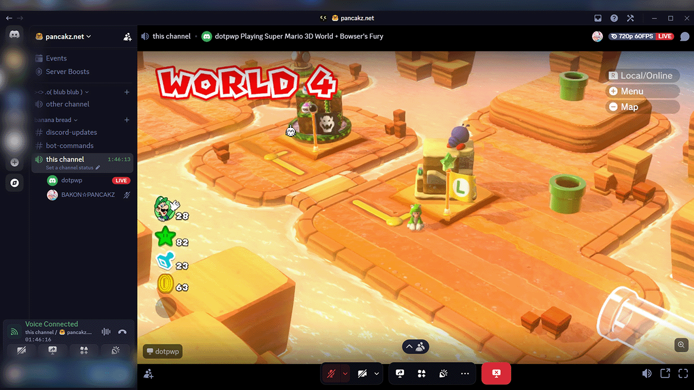
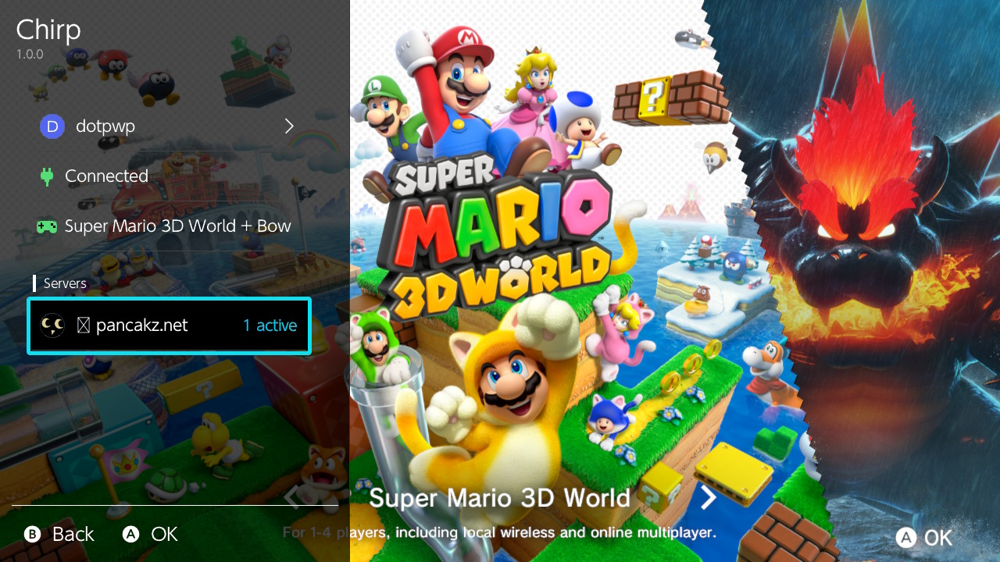
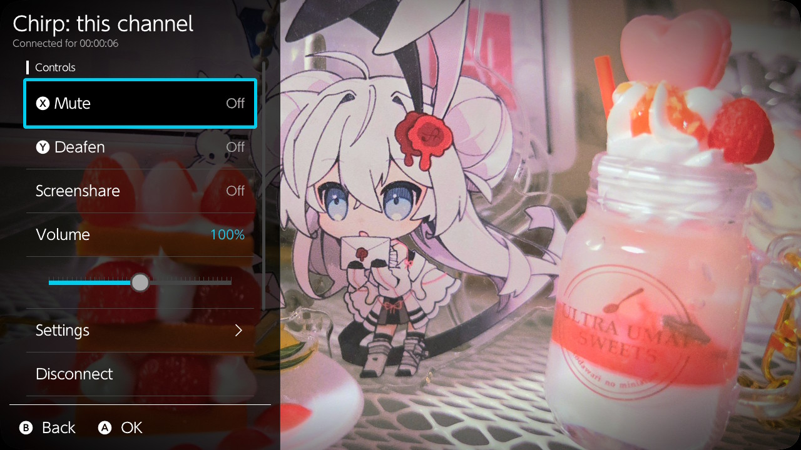
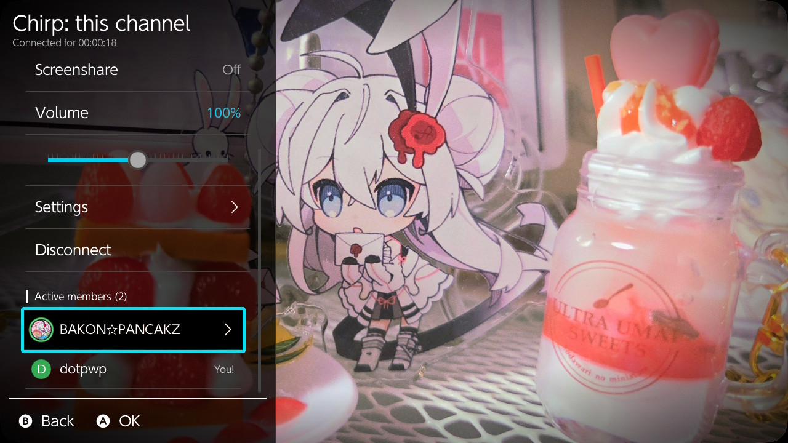

```
----------------
   sys-chirp
----------------

A discord client for the Nintendo Switch which supports RPC, voice chat, and
screensharing. Additionally includes other helpful features such as:

- Noise Suppression (via RNNoise v0.2)
- HOME Button Talking Indicator
- Avatars and Server Icons in the Overlay
- Global volume and per user volume controls (0%-200% sliders)
- Full Range Colorspace Support

<!> For this sysmodule you will require either 8MB of free sysmodule memory or
    the latest custom firmware (Currently: AMS 1.12.2; FW 23.5.0)

<!> Although technically this project does support User Tokens it is against 
    the Discord ToS, use them at your own risk.

[ Made with AI ]


----------------
  Installation
----------------

(1) Install Ultrahand
(2) Create a Bot and retrieve its token
(3) Invite the bot with permission to: View Channels, Connect, Speak, and Video.
(4) Copy the atmosphere, config, and switch folders from 'sys-chirp.zip' to the 
    root of your SD Card.
(5) Optionally (read below), Copy the atmosphere folder from 'patches.zip' to 
    the root of your SD Card.
(6) Place token into '/config/sys-chirp/token.ini' on your SD Card similar to 
    the following format. (or use 'token.example.ini' which is already there)

"""
Bot #1=xxxxxxxx.xxxxxxxxxxxxxxxxxxxx.xxxxxxxxxx
Bot #2=xxxxxxxx.xxxxxxxxxxxxxxxxxxxx.xxxxxxxxxx
"""

(7) Restart your Nintendo Switch if already powered on, DO IT.
(8) Open Ultrahand and select Chirp, from there you can configure it further.


----------------
    Patches
----------------

For the best experience we recommend installing a series of patches and 
configuration values to your switch. They are optional but should be installed
together as alone they introduce a series of minor but still present side 
effects (lame)

Compatible with the following firmware versions, do not install if your 
firmware is not listed:
- 23.5.0

|  Configuring Atmosphere  |

Append the following options to your atmosphere configuration located at
'sdmc:/atmosphere/config/system_settings.ini'

"""
[am.debug]
continuous_recording_fps = u32!60
continuous_recording_key_frame_count = u32!60
continuous_recording_video_bit_rate = u32!7000000
"""

Your switch will now record videos at 60 FPS and record at a slightly better
quality at the cost of consuming a little more disk space per recording.

|  Installing System Patches  |

Provided separately as 'patches.zip' they will improve your switch by:

<?> Prevent the HOME overlay from ducking audio (breaks the game volume slider)
<?> Allows the switch to record and playback Full RGB Color improving the color
    accuracy of recordings.
<?> Slightly improves recording quality by using the video encoder’s highest 
    quality preset
<?> Patches the Album applet to properly playback these new recording features.

|  Third-Party Patches  |

I recommend installing 'dvr-patches' as it allows games that block recording to 
be streamed and disables watermarks (most notoriously project diva)

https://github.com/exelix11/dvr-patches


----------------
    Caveats
----------------

<!> Screenshare can only display the active game, entering the HOME menu or
    the appearance of certain menus will cause a "Be Right Back" screen to be 
    sent instead. You can create your own with the included python scripts or
    delete them all to use the internal solid grey placeholder instead.
    
    NOTE: Originally Chirp did share the entire screen but certain applets and
    menus caused the cpu core reserved for system to cap out, and I considered
    it too buggy and resource intensive for not much gain.

<!> Bots cannot share their screen, you will be disconnected by Discord for
    attempting to do so.

<!> A headset with a microphone attached to the headphone jack is required to
    speak as the Nintendo Switch itself does not include a microphone (lame)

<!> Up to eight people can be heard speaking at once.

Include your logfile at 'sdmc:/config/sys-chirp/chirp.log' if you are reporting
an issue.


----------------
  Screenshots
----------------
```

<table>
  <tr>
    <td width="50%"></td>
    <td width="50%"></td>
  </tr>
  <tr>
    <td width="50%"></td>
    <td width="50%"></td>
  </tr>
</table>
